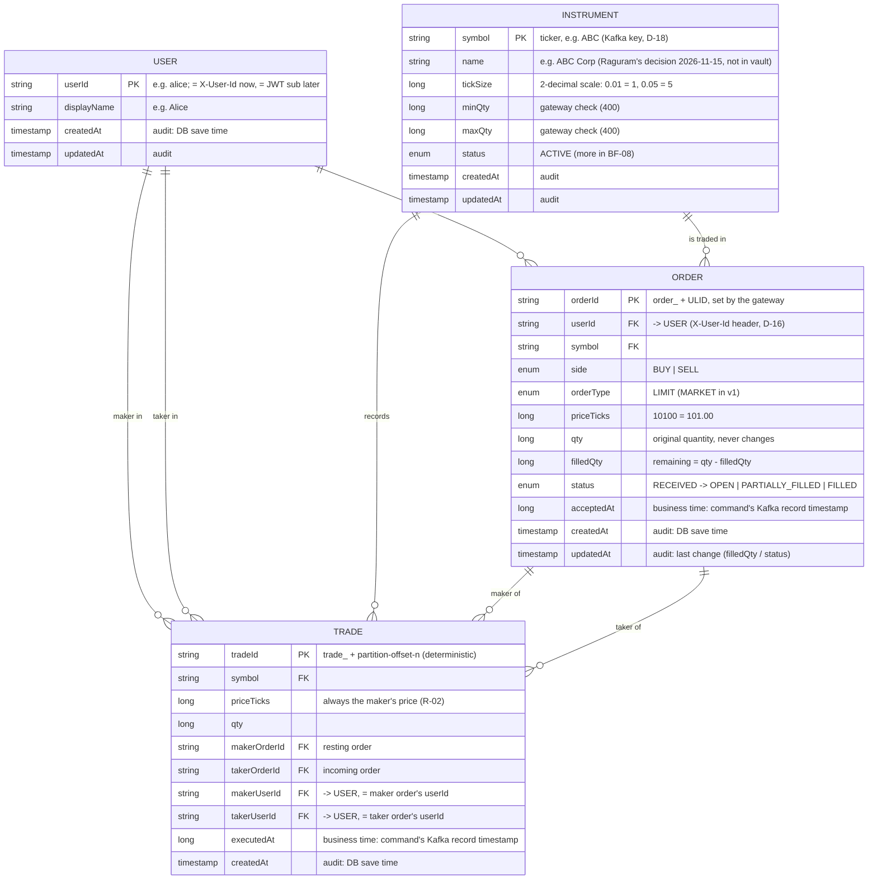

# Domain ER — ZetaX

A **domain** model: what exists and how it relates. It feeds three places:
engine memory (`Order`, `PriceLevel`, `OrderBook`) · Kafka messages (commands, events) · Postgres tables (vault B7).
It grows **one flow at a time**. Every field comes from the vault or from Raguram's decisions (marked); nothing invented.

Current version: **v0.3 — BF-02 full placement flow** (gateway → engine → persistor → Postgres; decisions in `flows/BF-02-place-limit-order.md`)

## Notes
- **v0.3 data access (2026-11-17):** `zetax-persistor` does **all** writes; `zetax-gateway` only reads (`instruments`, `users`) with a `SELECT`-only DB user; `zetax-engine` never touches the DB. Schema lives in `zetax-db/` (Flyway, run once before the apps). Shared DB records (plain Java) are in `zetax-common`; DB access with JDBC, not JPA.
- **Two kinds of time (v0.3):** business time (`acceptedAt`, `executedAt`) comes from the command's Kafka record timestamp, so replay gives identical values; audit time (`createdAt`, `updatedAt`) is the persistor's `now()`. Execution time lives on TRADE only (one order, many trades). The `status` column is derived by the persistor: `OPEN` on `OrderAccepted`, then `PARTIALLY_FILLED` / `FILLED` from trades.
- **Ids (v0.3):** `orderId = order_ + ULID` (time-sortable → good index locality); `tradeId = trade_ + partition-offset-n` (deterministic); `eventId = partition-offset-n` (de-dup key, unprefixed).
- **INSTRUMENT, not ASSET** (2026-11-15): an instrument is something *tradable* with its own rules (tick size, band, status); `symbol` is its short code. "Asset" is kept for what users *own* (balances, ZetaWallet later). Code, Kafka and vault keep the word "symbol" for the code/key.
- **USER exists before auth** (Raguram, 2026-11-16; overrides D-16/B7 "users only with auth", vault not updated): fields `userId` + `displayName` only; seeded by a Flyway seed that runs **only in the dev/demo profile**; identity is still the `X-User-Id` header.
  - Checked **only in the gateway** (stateless, before Kafka). Unknown user → **`401`**. The engine **never reads** the users table (replay determinism, same reason as D-20).
  - `createdAt = now()` would be fine here later: users are not event-sourced and the gateway is never replayed.
- **TRADE has two user FKs** (`makerUserId`, `takerUserId`): copies of the two orders' `userId`, for "my trades" without a join (vault B2 event already carries them). Agree by construction (engine builds both from the same order); DB options for J8: composite FK `(maker_order_id, maker_user_id) → orders(order_id, user_id)` and `CHECK (maker_user_id <> taker_user_id)` (self-trade prevention, R-08).
- **A trade links exactly two orders**: one maker (resting), one taker (incoming). One order can be in many trades (partial fills).
- **Store facts, derive views:** trades are facts; remaining qty, average price and slippage are computed, never stored.
- **`qty` + `filledQty`, remaining is derived**: the invariant `filled + remaining = qty` can't break, and the original quantity is kept.
- **TRADE keeps its own `symbol`** (B7): "trades for ABC" by index, no join. Deliberate denormalization.

## Versions

| Version | Flow | Change | Status |
|---|---|---|---|
| v0 | BF-02 limit order | SYMBOL, ORDER, TRADE | done 2026-11-15 |
| v0.1 | naming | SYMBOL → INSTRUMENT; `name` added | done 2026-11-15 |
| v0.2 | base model | USER (seeded until auth); `userId` FK on ORDER; `makerUserId` / `takerUserId` FKs on TRADE | done 2026-11-16 |
| v0.3 | BF-02 full flow | Timestamps (business + audit), prefixed ids, INSTRUMENT `tickSize` as `long` + `minQty` / `maxQty` (moved up from v3: the gateway checks them now), data-access notes | done 2026-11-17 |
| v1 | BF-03 market order | `priceTicks` nullable; `reason` (`NO_LIQUIDITY`, `PRICE_BAND`) | todo |
| v2 | BF-04 cancel + STP | `CANCELLED` status, more `reason` values, ownership via `userId` | todo |
| v3 | BF-08 admin | INSTRUMENT: `bandPercent`, `referencePriceTicks`, `HALTED` / `DELISTED` | todo |
| v4 | Persistence details | `event_id` idempotency columns, indexes (timestamps moved to v0.3) | todo |
| later | Auth add-on | USER gets credentials / roles; JWT `sub` = `userId` | parked |
