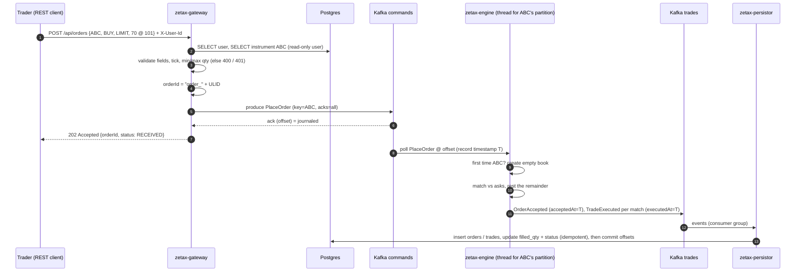

# BF-02 · Place a limit order

*"Buy 70 ABC at 101 or better."* Back to the [flow index](README.md) · states: [ORDER-LIFECYCLE.md](ORDER-LIFECYCLE.md) v0.

**Scope (decided 2026-11-17): the full placement flow.** Web/REST → gateway → `commands` → engine matches → events on `trades` → persistor → Postgres.
Not in this flow (own flows later): market data / WebSocket, replay after a crash, admin endpoints, cancel, market orders.

**Command → events:** `PlaceOrder` → `OrderAccepted`, then `TradeExecuted` × n (one per match).
Gateway rule failures (fields, unknown symbol, tick, min/max qty) → HTTP `400`; unknown user → `401`; no event.

## Components

| # | App | Job | DB access |
|---|---|---|---|
| 1 | `zetax-gateway` | Validate, create `orderId`, send `PlaceOrder`, answer `202 {orderId, RECEIVED}` | **read-only** (`instruments`, `users`) |
| 2–3 | `zetax-engine` | Match (price-time, maker price), rest the remainder, emit events | **none, ever** |
| 4 | `zetax-persistor` (new) | Read `trades` events, save `orders` + `trades` | **owner of all writes** (insert / update / delete) |
| — | `zetax-db/` (new folder, SQL only) | Flyway migrations: tables, seeds, DB users + grants; run once by the Flyway Docker image before the apps start | schema owner |

## Sequence



## Decisions (2026-11-17, Raguram)

| # | Topic | Decision |
|---|---|---|
| 1 | Way of working | One flow at a time; only this flow's contracts are built. One document per flow in `docs/flows/` |
| 2 | Scope | Full placement flow (boxes 1–4 above), no market data |
| 3 | Status `RECEIVED` | Kept. Set by the gateway's `202`; engine events move the order on (OPEN / PARTIALLY_FILLED / FILLED) |
| 4 | Tick size | `long`, fixed **2-decimal** price scale (101.00 → `10100`); `tickSize` is a `long` in the same units (0.05 → `5`); valid iff `priceTicks % tickSize == 0` |
| 5 | Persistence app | New Java app **`zetax-persistor`** (own Maven module, depends on `zetax-common` only). Changes D-21 (3 → 4 modules) |
| 6 | DB ownership | Persistor does **all** writes. Gateway: read-only. Engine: never reads the DB. Schema changes: `zetax-db/` (decision 22) |
| 7 | DB users | Two Postgres users: `zetax_persistor` (full rights), `zetax_gateway` (`SELECT` only): least privilege, enforced by Postgres |
| 8 | Tables for this flow | `instruments`, `users` (seeded by Flyway, dev profile), `orders`, `trades` |
| 9 | Instruments | Seeded by Flyway for now; admin endpoint comes with BF-08 |
| 10 | Engine book | Created the first time the engine sees a symbol in `PlaceOrder` (the gateway already checked it exists). `AddSymbol` takes over in BF-08 |
| 11 | JSON | Type info (`"type"`) on the contracts in `zetax-common` via `jackson-annotations` (no Spring, D-21 holds). Dependency approved in principle; exact artifact/version checked against the Boot 4.1 BOM (Jackson 3) when added |
| 12 | `OrderAccepted` | Carries the **full order** (event-carried state transfer). No status in events: the persistor derives it (`OPEN` on accept, `PARTIALLY_FILLED` / `FILLED` from trades). FIX-style execution report (status + cumulative qty in events) considered 2026-11-18, not chosen |
| 13 | Business time | Engine copies the command's **Kafka record timestamp** into events: `acceptedAt` (`OrderAccepted`), `executedAt` (`TradeExecuted`), epoch millis `long`. Stored as `orders.accepted_at`, `trades.executed_at`. No execution time on the order (one order, many trades) |
| 14 | Audit time | `created_at` / `updated_at` on rows = the persistor's `now()` (when the row was saved / changed) |
| 15 | `orderId` | `"order_" + ULID`, created by the gateway with a ULID library (e.g. `ulid-creator`; status/version checked when added). IDs the engine creates stay deterministic (`partition-offset-n`) |
| 16 | Redis | Parked: only if benchmarks show the gateway's reference-data reads are too slow |
| 17 | Testing | Test pyramid: many unit tests (book), slice tests (gateway API), integration tests with **Testcontainers** (persistor + real Postgres/Kafka), **golden-file** JSON tests for the contracts, 1–2 end-to-end tests (POST → Postgres). Testcontainers = new test dependency (versions/class names checked for Boot 4.1 when added). `docker-compose` stays for running the apps locally |
| 18 | `clientOrderId` | Not in this flow. Known gap: a retry after a lost `202` creates a second order. Gets its **own flow** ("Safe retries", planned in the flow index) with its own learning session |
| 19 | Validation layers | **Record** compact constructor: rules always true (no nulls, `qty > 0`, `priceTicks > 0`). **Gateway**: rules needing data (tick multiple, min/max qty, symbol + user exist). **Engine**: rules needing the book. A command that fails to deserialize on Kafka = poison: rejected, the engine thread never dies |
| 21 | Where classes live | **Used by more than one app → `zetax-common`; used by one app → that app.** Common: Kafka messages, enums, DB data records (`Instrument`, `User`, `Order`, `Trade`, plain records, no Spring/JPA, own package e.g. `com.zetax.common.model`). Per app: REST DTOs (gateway), the engine's mutable book order (engine; distinct name, e.g. `BookOrder`, decided at build). DB access with JDBC (`JdbcClient`), not JPA |
| 22 | Migrations | Separate folder **`zetax-db/`** (SQL only: `V1__…sql`), run as a one-off **Flyway Docker image** step in docker-compose before the apps start (later: a Kubernetes `Job`). Holds tables, dev seeds (instruments, users) and the two DB users + grants. Not in `zetax-common`. Flyway removed from the gateway pom; the persistor runs no migrations either |
| 23 | Enum storage | Java code and Kafka JSON use the enum **names** (`BUY`, `"BUY"`). The DB stores `SMALLINT` codes with gaps, defined **on the enum** (`BUY(5)`, `SELL(10)`; `LIMIT(5)`; `RECEIVED(5)`, `OPEN(10)`, `PARTIALLY_FILLED(15)`, `FILLED(20)`), via `code()` / `fromCode()`; never `ordinal()`. Only the DB layer calls them. A `CHECK` constraint lists the valid codes (2026-11-19) |
| 24 | JSON type labels | Fixed contract values written by us: `PLACE_ORDER`, `ORDER_ACCEPTED`, `TRADE_EXECUTED` (UPPER_SNAKE, full names), set with `@JsonTypeInfo` / `@JsonSubTypes` on the sealed interfaces. Never derived from Java class names, never renamed once a message exists on Kafka (2026-11-19) |
| 25 | Kafka topic names | `<project>.<env>.<component>.<topic>-<direction>`: `<component>` = owner of the topic's contract, direction from the owner's view → `zetax.<env>.engine.commands-inbound` (EngineCommand), `zetax.<env>.engine.events-outbound` (EngineEvent; replaces the vault's `commands` / `trades`). `<env>` from `ZETAX_ENV` (default `local`); only dots between segments. Each app declares the topics it uses in its own `application.yml`; only the engine holds `zetax.kafka.partitions=3` (D-18), guarded by a test in J5; the end-to-end test (J10) catches name mismatches. Nothing Kafka-related in `zetax-common` (2026-11-19, Raguram's company convention) |
| 20 | Engine ID prefix | `tradeId = "trade_" + partition-offset-n` (e.g. `trade_2-1532-1`), still deterministic (constant prefix). `eventId` stays `partition-offset-n` (`2-1532-1`): no prefix, no orderId (one command → events about several orders), no hash (unreadable). Reason for `trade_`: entity type visible in logs/DB, easier audit and debugging |

## Contracts (draft from the decisions)

Package layout in `zetax-common` (2026-11-19, Raguram):
```
com.zetax.common
├── order/          Order (DB record, J8) · enums/ Side, OrderType, OrderStatus
├── trade/          Trade (DB record, J8)
├── command/        EngineCommand (sealed), PlaceOrder
├── event/          EngineEvent (sealed), OrderAccepted, TradeExecuted
```

```java
// zetax-common
enum Side { BUY, SELL }
enum OrderType { LIMIT }
enum OrderStatus { RECEIVED, OPEN, PARTIALLY_FILLED, FILLED }

sealed interface EngineCommand permits PlaceOrder { String symbol(); }     // everything on the `commands` topic; symbol = Kafka key
record PlaceOrder(String orderId, String userId, String symbol,
                  Side side, OrderType orderType, long priceTicks, long qty) implements EngineCommand

sealed interface EngineEvent permits OrderAccepted, TradeExecuted {
    String eventId(); String symbol(); long sourceOffset(); }
record OrderAccepted(String eventId, String symbol, long sourceOffset,
                     String orderId, String userId, Side side, OrderType orderType,
                     long priceTicks, long qty, long acceptedAt) implements EngineEvent
record TradeExecuted(String eventId, String symbol, long sourceOffset, String tradeId,
                     long priceTicks, long qty, String makerOrderId, String takerOrderId,
                     String makerUserId, String takerUserId, long executedAt) implements EngineEvent
```

## Still open (one at a time)
- ER.md v0.3 (timestamps, prefixed `orderId`) and `TASKS.md` re-ordered around this flow: after the plan is final

## Notes for the build
- **J8 idempotent update:** per `TradeExecuted`, in **one DB transaction**: insert the trade (`ON CONFLICT (trade_id) DO NOTHING`); **only if it was newly inserted**, add `qty` to `filled_qty` of both the maker and the taker order, set their status (`filled_qty = qty` → FILLED, else PARTIALLY_FILLED) and `updated_at`. A duplicate event must never add the fill twice.

## Notes for later flows
- **BF-08 admin:** with a read-only gateway, "DB first, then `AddSymbol`" (vault TF-08) can't work. Likely: gateway sends `AddSymbol` → engine `SymbolAdded` → persistor saves the instrument. Decide in BF-08.
- **Market data / WebSocket:** separate flow (D-22 still open).

## Design progress (`design-flow` skill)
- [x] 1. Plain words: 4 boxes, scope = full placement flow (2026-11-17)
- [x] 2. Business check: A1–A3 (lifecycle), commands vs events (2026-11-17)
- [x] 3. Decisions: 1–22 (2026-11-17)
- [x] 4. Contracts + diagrams: draft contracts, sequence diagram, lifecycle v0
- [x] 5. Data model: `ER.md` v0.3
- [x] 6. Build plan: `TASKS.md` J1–J10
- [x] 7. Explain-back: passed with corrections (2026-11-18)

