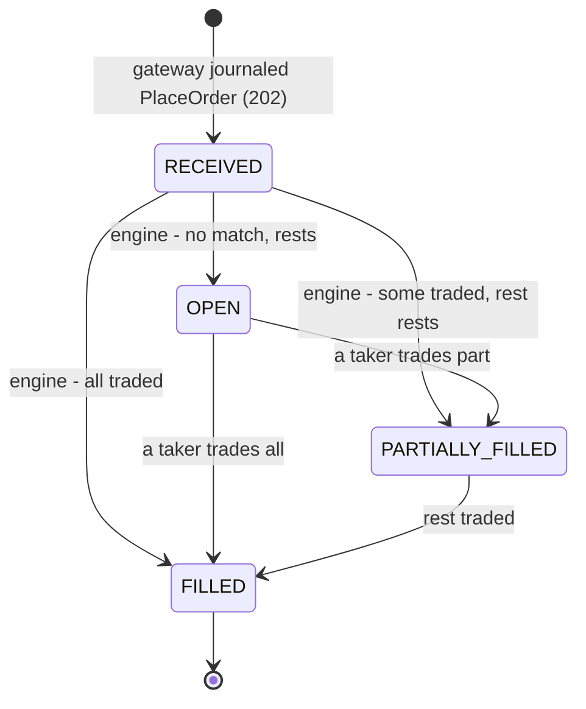

# Order lifecycle

Grows one version per flow. Back to the [flow index](README.md).

| Version | Flow | Added |
|---|---|---|
| v0 | [BF-02](BF-02-place-limit-order.md) place limit | RECEIVED, OPEN, PARTIALLY_FILLED, FILLED |

- RECEIVED is set by the gateway (the `202` answer); every later state comes from engine events.
- An order that trades on arrival skips OPEN.
- A resting (maker) order changes state because of someone else's command.
